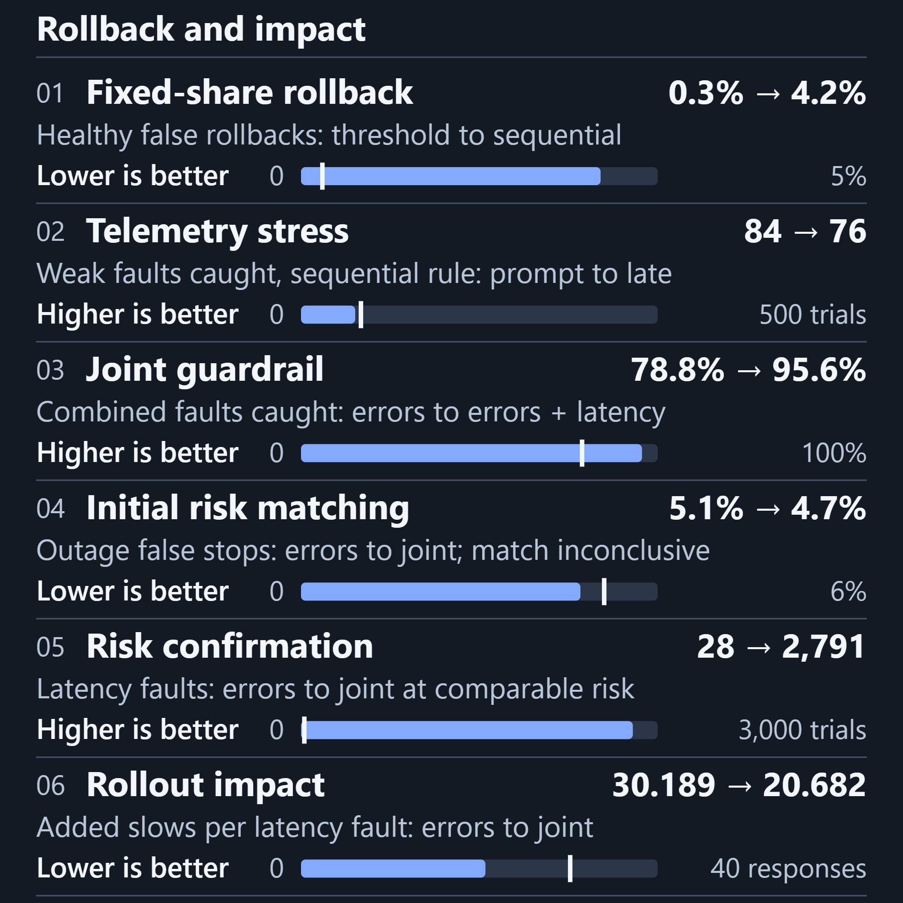
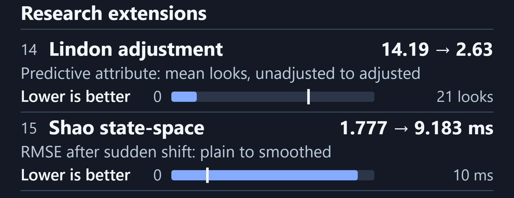

# Mihari

Mihari compares canary rollback rules. How often do they roll back a healthy
release, how quickly do they catch a regression, and how many requests reach
the bad version before it stops?

## Motivation

A canary sends a small share of real traffic to a new version before
expanding the rollout. Waiting too long to act exposes more requests to a
bad release. Acting on noise can interrupt a healthy one.

- [Netflix](https://arxiv.org/html/2205.14762v2) used a sequential test to
  catch slower playback starts before a client release went wider.
- [Cloudflare](https://blog.cloudflare.com/details-of-the-cloudflare-outage-on-july-2-2019/)
  traced a global outage to a firewall rule deployed worldwide at once and
  announced staged rollouts for routine rule changes.
- [Microsoft Azure](https://learn.microsoft.com/en-us/azure/well-architected/mission-critical/mission-critical-application-platform)
  runs canary and pilot phases before updating one member of each region
  pair at a time.
- [Argo Rollouts](https://argoproj.github.io/argo-rollouts/features/analysis/)
  can raise traffic in stages and abort after a configured number of
  failed metric checks.
- [Kayenta](https://cloud.google.com/blog/products/gcp/introducing-kayenta-an-open-automated-canary-analysis-tool-from-google-and-netflix)
  tests individual metrics and combines them into a score used to promote,
  pause for review, or roll back.
- [LaunchDarkly](https://launchdarkly.com/changelog/sequential-testing-guarded-releases/)
  uses sequential tests and adjusts for checking multiple metrics to
  limit false alarms.

Mihari compares rollout rules under controlled faults and noisy traffic.
It does not implement or benchmark these tools.

## Try it locally

```bash
python -m pip install -e ".[dev]"
python -m mihari.live --joint-guardrail
```

Two local HTTP listeners receive a 90/10 control-to-canary split. The client
measures latency on real requests with scripted faults. Watch the latency rule
roll back on slow HTTP 200s, route the next probe to control, and hold when
too few outcomes arrive by the simulated telemetry deadline.

## What the studies found

- [Repeated checks raise false alarms.](docs/studies.md#original-benchmark)
  At 20 looks, naive peeking rolled back 21.5% of healthy runs in the original
  benchmark, versus 5.1% for one planned test.
- [Correlated requests can cause false rollbacks even at one check.](docs/clustered-requests.md)
  With retry-like bursts and identical versions, the request-level rule
  rolled back 16.5% of runs; the tenant-level rule rolled back 4.0%.
  [Combining bursts and repeated checks](docs/clustered-looks.md) shows why
  correcting only the checking schedule isn't enough.
- [Latency and error triggers trade off.](docs/risk-confirmation.md)
  At comparable modeled false-rollback risk, the joint rule caught more
  latency-only and combined faults. The error-only rule caught more
  error-only faults.
- [A smaller stage can postpone the fault.](docs/staged-risk.md)
  The adaptive 15% stage could defer a share-triggered fault until 50%.
  The fixed schedule exposed fewer requests even when both schedules
  encountered the fault at the same time.
- [Averages can hide local harm.](docs/regional-risk.md)
  Adding a regional trigger caught more local regressions, but the
  fitted rules' false-rollback rates were not comparable across scenarios.
  [Adjusting for sample precision](docs/regional-precision.md) brought the
  rates within the declared margin across the three modeled scenarios.
- [An early SLO hold can miss the recovery.](docs/slo-gate.md) It held four ticks sooner
  during a sustained shared outage, but blocked 219 of 1,000 rollouts that the
  checkpoint-only policy promoted after a short outage recovered.

## 15-study scorecard

Each row has its own metric and scale. The tick marks the comparator where
there is one; the bar shows the study result. The labels say which direction
is better, including cases where the addition did not improve the result.






[Full-size vector scorecard](docs/charts/study-scorecard.svg)

The benchmarks use simulations. The [recorded-trace replay](docs/recorded-traces.md)
uses measured timings from six testbed recordings, with simulated canary
assignments and an added slowdown. Neither establishes production safety.

## Outcome

The goal was to send fewer requests to a bad release without causing more
false rollbacks or unnecessarily holding healthy releases. The studies
showed why those outcomes need to be measured together:

- **Compare at similar false-rollback risk.** Checking repeatedly and
  counting correlated retries as independent can both inflate false
  rollbacks. Correcting both brought risk down, but splitting the budget
  evenly across checks missed most regressions under retry bursts.
- **Separate release regressions from shared outages.** Latency and regional
  checks can reveal faults that error rates or global averages miss. A
  shared outage calls for a different decision, and a terminal hold can
  block a healthy release after the outage clears.
- **Count exposure, not just detections.** A regional rule caught many
  more faults but spared few requests because the evidence arrived late.
  A smaller rollout step could postpone a load-triggered fault until more
  traffic was on the canary.
- **Keep a simple baseline.** Adjustment helped when a pre-routing
  attribute predicted latency. A fixed schedule beat the adaptive ramp
  we tested on exposure, and plain averaging beat smoothing after a
  sudden shift.

### Industry use

One row per scorecard study. "Similar approach in production" means a
company used the same general approach, not Mihari's exact rule.
"Not verified" means no public match was found in the sources reviewed.

| # | Study | Public evidence |
| --- | --- | --- |
| 01 | [Fixed-share rollback](docs/fixed-exposure.md) | **Similar approach in production.** [Shopify](https://shopify.engineering/software-release-culture-shopify) documented a fixed-share canary with alert-gated promotion. [Netflix](https://arxiv.org/html/2205.14762v2) used sequential tests in canary release gates. |
| 02 | [Telemetry stress](docs/telemetry-stress.md) | **Related.** [Microsoft](https://arxiv.org/abs/1903.12470) documented bias from telemetry loss in live experiments. |
| 03 | [Joint guardrail](docs/joint-guardrail.md) | **Similar approach in production.** [Google](https://cloud.google.com/blog/products/gcp/how-release-canaries-can-save-your-bacon-cre-life-lessons) and [Uber](https://www.uber.com/au/en/blog/raising-the-bar-on-ml-model-deployment-safety/) describe automatic rollbacks that monitor both errors and latency. |
| 04 | [Initial risk matching](docs/matched-risk.md) | **Related.** [Google and Waze](https://cloud.google.com/blog/products/devops-sre/canary-analysis-lessons-learned-and-best-practices-from-google-and-waze) recommend testing identical versions for false alarms, not matching risk across two rules. |
| 05 | [Risk confirmation](docs/risk-confirmation.md) | **Not verified.** No public match for freezing two rules and confirming comparable false-rollback rates on fresh runs. |
| 06 | [Rollout impact](docs/rollout-impact.md) | **Related.** [Google SRE](https://sre.google/workbook/canarying-releases/) compares rollout impact on the error budget in a worked example. |
| 07 | [Fixed-step rollout](docs/fixed-steps.md) | **Similar approach in production.** [Cloudflare](https://blog.cloudflare.com/builder-day-2024-announcements/) uses preset traffic shares and checks metrics between stages for its Workers services. |
| 08 | [Adaptive middle stage](docs/adaptive-steps.md) | **Not verified.** No public match for choosing the next canary share from the checkpoint's estimated harm bounds. |
| 09 | [Staged risk](docs/staged-risk.md) | **Related.** [Google SRE](https://sre.google/workbook/canarying-releases/) warns that off-peak canaries can miss load-related faults, but doesn't compare our two ramp schedules. |
| 10 | [Recorded-trace replay](docs/recorded-traces.md) | **Related.** [Netflix](https://netflixtechblog.com/migrating-critical-traffic-at-scale-with-no-downtime-part-1-ba1c7a1c7835) replays production requests to validate migrations. Mihari replays testbed timings and injects a slowdown. |
| 11 | [Regional traffic mix](docs/regional-guardrail.md) | **Related.** [Google and Waze](https://cloud.google.com/blog/products/devops-sre/canary-analysis-lessons-learned-and-best-practices-from-google-and-waze) recommend matching traffic type and volume across versions. |
| 12 | [Regional triggers](docs/regional-risk.md) | **Similar approach in production.** [Amazon](https://aws.amazon.com/builders-library/automating-safe-hands-off-deployments/) uses region- and canary-scoped alarms. |
| 13 | [Regional precision](docs/regional-precision.md) | **Related.** [Statsig](https://docs.statsig.com/metrics/rollout-alerts) supports minimum sample counts for rollout alerts. |
| 14 | [Lindon adjustment](docs/lindon-adjustment.md) | **Company data.** [Lindon et al.](https://doi.org/10.1080/01621459.2026.2692052) applied regression adjustment to Netflix A/B tests; use as a rollout gate wasn't established. |
| 15 | [Shao state-space](docs/shao-allocation.md) | **Research only.** [Shao et al.](https://proceedings.mlr.press/v300/shao26a.html) reported simulations; no production rollout use was verified. |

Outside the scorecard:

- [Spotify](https://engineering.atspotify.com/2023/3/choosing-sequential-testing-framework-comparisons-and-discussions)
  uses group-sequential tests in product experiments to address the peeking
  problem in the [original benchmark](docs/studies.md#original-benchmark).
- [LinkedIn](https://engineering.linkedin.com/content/dam/me/engineering/li-en/research/In-partnership-with-MIT.pdf)
  used cluster randomization in live experiments to study network effects,
  rather than the retry bursts modeled in our [tenant study](docs/clustered-requests.md).

Neither source describes the same rollback rule.

**Verdict.** No policy won across all the workloads we tested. Keep preset
stages that advance only when the canary passes checks against control as
the benchmark. Switch policies only if tests on representative traffic
show fewer requests reaching bad releases at similar false-rollback risk,
without more unnecessary holds.

See the [study guide](docs/studies.md) for every experiment, the original
benchmark table, and commands to reproduce them.
