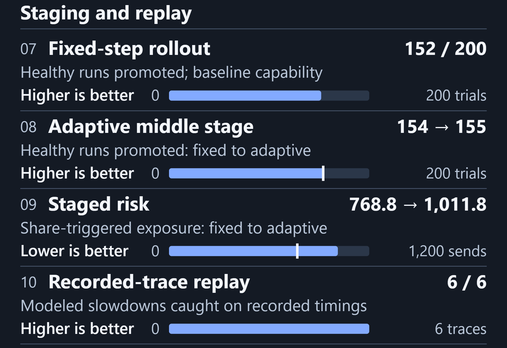
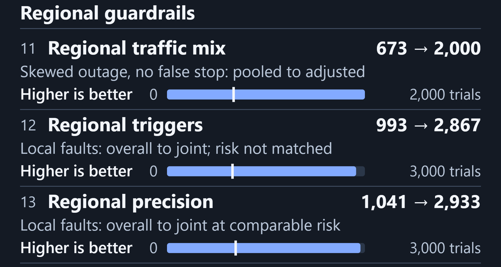

# Mihari

Mihari compares canary rollback rules. How often do they roll back a healthy
release, how quickly do they catch a regression, and how many requests reach
the bad version before it stops?

**見張り (mihari)** means "lookout, watch".

## Try it locally

```bash
python -m pip install -e ".[dev]"
python -m mihari.live --joint-guardrail
```

Two local HTTP listeners receive a 90/10 control-to-canary split. The client
measures latency on real requests with scripted faults. Watch the latency rule
roll back on slow HTTP 200s, route the next probe to control, and hold when
too few outcomes arrive by the simulated telemetry deadline.

## What the studies found

- [Repeated checks raise false alarms.](docs/studies.md#original-benchmark)
  At 20 looks, naive peeking rolled back 21.5% of healthy runs in the original
  benchmark, versus 5.1% for one planned test.
- [Latency and error triggers trade off.](docs/risk-confirmation.md)
  At comparable modeled false-rollback risk, the joint rule caught more
  latency-only and combined faults. The error-only rule caught more
  error-only faults.
- [A smaller stage can postpone the fault.](docs/staged-risk.md)
  The adaptive 15% stage could defer a share-triggered fault until 50%.
  The fixed schedule exposed fewer requests even when both schedules
  encountered the fault at the same time.
- [Averages can hide local harm.](docs/regional-risk.md)
  Adding a regional trigger caught more local regressions, but the
  fitted rules' false-rollback rates were not comparable across scenarios.
  [Adjusting for sample precision](docs/regional-precision.md) brought the
  rates within the declared margin across the three modeled scenarios.
- [An early SLO hold can miss the recovery.](docs/slo-gate.md) It held four ticks sooner
  during a sustained shared outage, but blocked 219 of 1,000 rollouts that the
  checkpoint-only policy promoted after a short outage recovered.

## 15-study scorecard

Each row has its own metric and scale. The tick marks the comparator where
there is one; the bar shows the study result. The labels say which direction
is better, including cases where the addition did not improve the result.







[Full-size vector scorecard](docs/charts/study-scorecard.svg)

The benchmarks use simulations. The [recorded-trace replay](docs/recorded-traces.md)
uses measured timings from six testbed recordings, with simulated canary
assignments and an added slowdown. Neither establishes production safety.

See the [study guide](docs/studies.md) for every experiment, the original
benchmark table, and commands to reproduce them.
